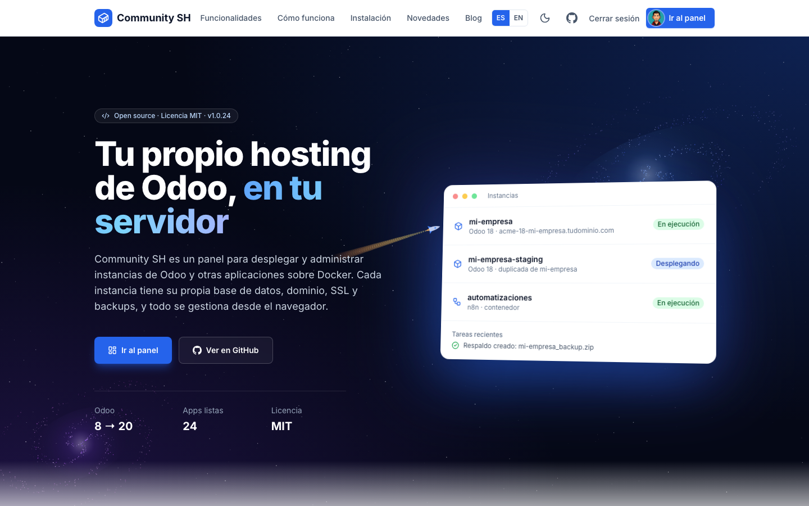
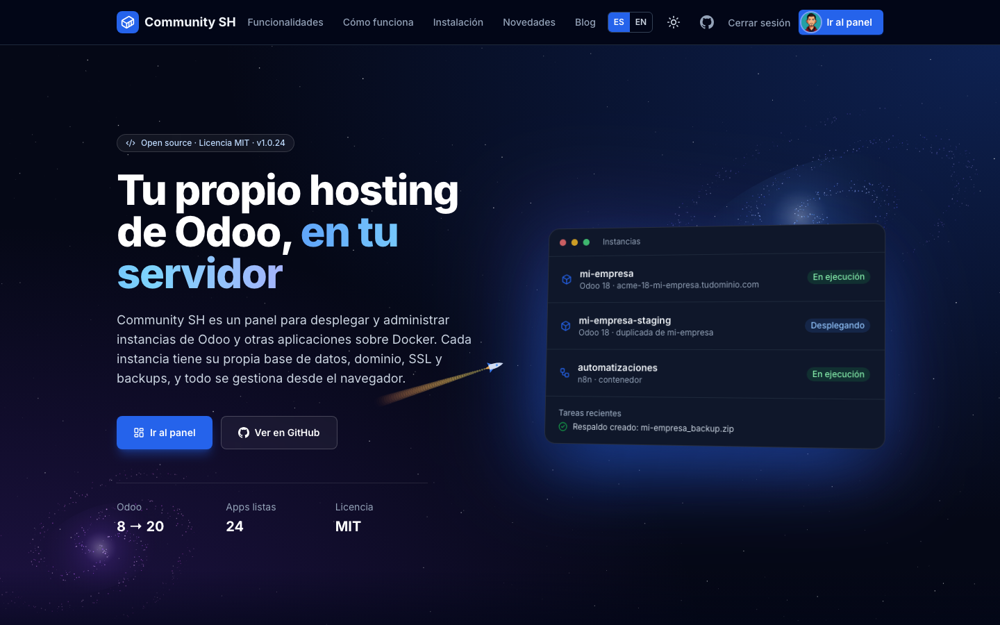
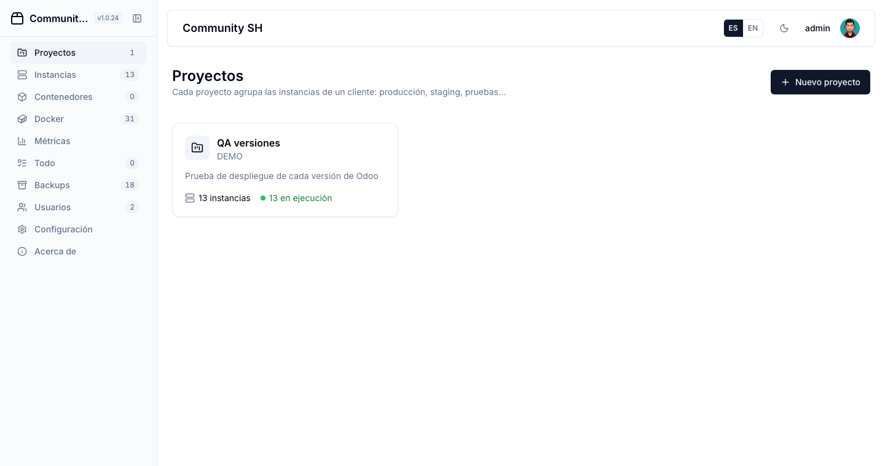
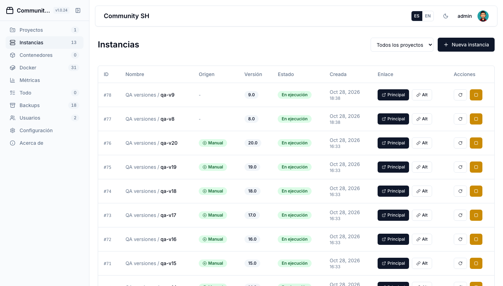
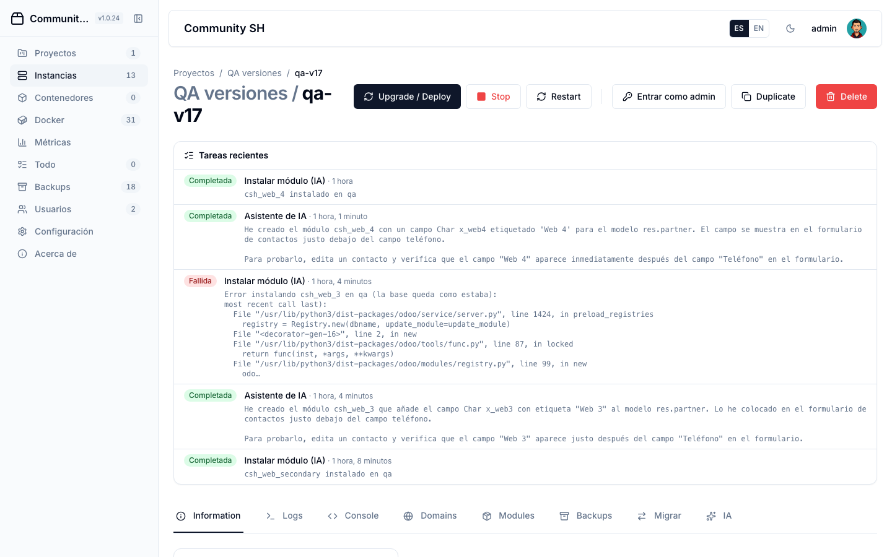
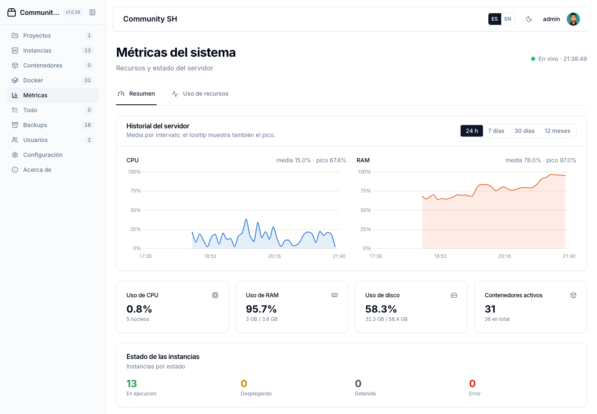
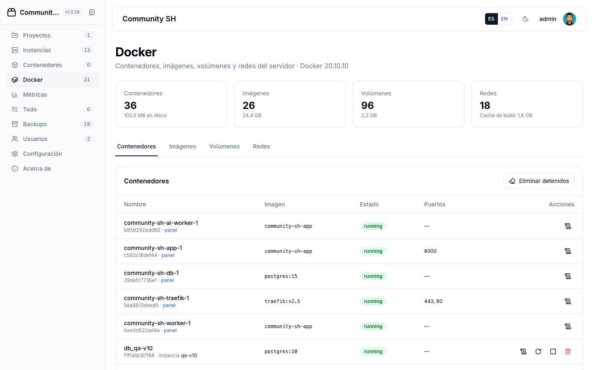
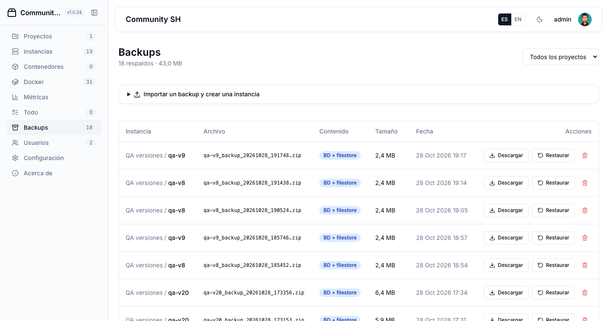
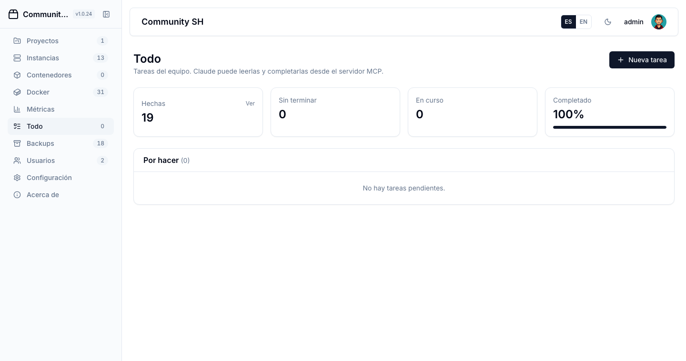
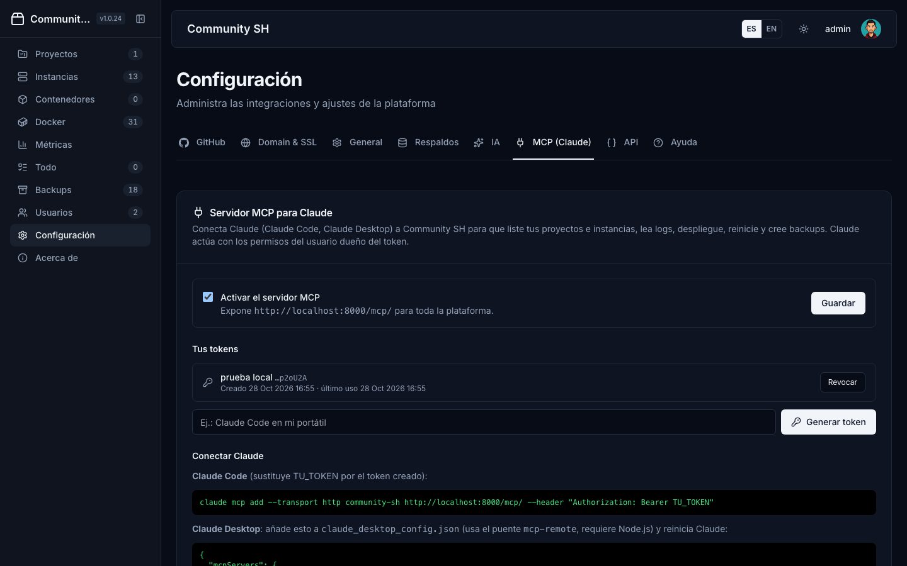

# Community SH - Odoo Hosting Orchestrator

🐳 Django-based orchestration platform for deploying and managing Odoo instances using Docker.

## ✨ Features
- 🚀 Deploy **Odoo 8 to 20** in Docker — every version tested end to end (deploy, database, login, backups, chat); each gets a matching PostgreSQL
- 🔒 **Automatic HTTPS**: the installer asks for your domain and an email, and Traefik issues and renews Let's Encrypt certificates for the panel and every instance
- 🌐 Each instance gets its own subdomain, `client-version-name.yourdomain.com`, covered by a single `*.yourdomain.com` DNS record; custom domains too
- 🔑 **Open Odoo as admin** from the panel without typing the password (signed, one-time link)
- 🗂️ **Projects** group a client's instances (shown as `project / instance`); a project's **client** is a user who can see and operate them
- 💾 Backups with database + filestore: manual or scheduled with retention, download, restore, import Odoo's own backups, create an instance from any backup, duplicate instances
- 🤖 **AI assistant** (ChatGPT) per instance: writes, validates and installs modules, fixes its own install errors, `@`-tags your modules, undo its changes
  - attach **PDFs, images or text files**; long requests become a live step-by-step plan, run in the background and can be stopped
  - also from Odoo: write **`/ia …`** in any record's chatter (Odoo 9-20) and the answer arrives there
- 🔄 **Migrate from another Odoo** (8 or later) over XML-RPC into Odoo 14+: contacts, categories, products and variants, sales, purchases, invoices and payments — re-runnable without duplicates
- 🎨 **Community SH Theme** for Odoo 15-20: light top bar, form sheets as cards and an app-grid home screen (original design)
- 🔌 **MCP server for Claude** (Claude Code / Claude Desktop) and a full **REST API** with personal tokens
- ⚙️ Long operations run in background **workers** (one for Docker jobs, one for AI and migrations), with live task status
- 🔗 GitHub integration: main repo with a branch per instance, plus **extra addons repositories**
- 📊 Live metrics and CPU/RAM history (24 h, 7 d, 30 d, 12 months); Docker management (containers, images, volumes, networks)
- ✅ **Todo** list for the team (Claude can complete items over MCP)
- 🔐 2FA (optional or mandatory), per-user permissions, login lockout, per-instance Odoo master password
- 🌓 Light/dark theme, 🇪🇸/🇬🇧 Spanish and English

## 📸 Screenshots

| | |
|---|---|
|  |  |
| **Landing** | **Landing — dark mode** |
|  |  |
| **Projects** | **Instances** |
|  |  |
| **Instance detail** | **Metrics and CPU/RAM history** |
|  |  |
| **Docker management** | **Backups** |
|  |  |
| **Todo** | **Settings — MCP for Claude** |

## 🚀 Quick Start

### Prerequisites
- Python 3.8+
- Docker Desktop (or Docker Engine) running
- Git

### 1. Configure DNS first

> ⚠️ **Do this before running the installer.** The installer asks for your main domain and
> Let's Encrypt can only issue the SSL certificates if the domain already points to the server.

At your DNS provider, create:

| Type | Name | Value |
|------|------|-------|
| `A` | `panel.example.com` (your main domain) | your server's public IP |
| `A` | `*.example.com` (optional, for instance subdomains) | your server's public IP |

Check it before installing (it may take a few minutes to propagate):
```bash
dig +short panel.example.com   # must print the server's IP
```
The installer verifies it too and warns you if the domain doesn't resolve to the server.
Without a domain you can still install and use the panel by IP (no HTTPS).

### 2. Installation

**Option 1: Quick Install (Recommended)**
Run this command on your fresh server:
```bash
curl -sL https://raw.githubusercontent.com/falconsoft3d/community-sh/main/easy-install.sh | sudo bash
```

**Option 2: Review and Run**
If you prefer to inspect the script first:
```bash
wget https://raw.githubusercontent.com/falconsoft3d/community-sh/main/easy-install.sh
chmod +x easy-install.sh
sudo ./easy-install.sh
```

**Option 3: Update**
```bash
git pull
docker-compose up -d --build
```
Migrations run automatically when the `app` container starts. The `cron` service was replaced
by `worker`; remove the old container with `docker-compose up -d --remove-orphans`.

> **Upgrading from versions that stored data in `db.sqlite3`:** if `.env` has a Postgres
> `DATABASE_URL` (the default from `easy-install.sh`), the first start copies `db.sqlite3`
> into Postgres automatically (`manage.py migrate_from_sqlite`) and keeps a
> `db.sqlite3.pre-migration-*.bak` copy. `.env` must define `DB_PASSWORD` and
> `DJANGO_SECRET_KEY`. Each Odoo instance now has its own master password (shown on the
> instance page); it is applied on the next redeploy.

**Docker Compose Commands Local**
```bash
docker-compose up -d --build app
docker-compose up -d --build
docker-compose logs -f worker
docker-compose restart app
docker-compose down
docker-compose logs --tail=100 app
```

```bash
sudo docker compose restart app
```

**Eliminar Dockers**
```bash
cd /opt/community-sh
sudo docker compose down
sudo docker compose down -v
sudo docker compose down -v --rmi all


sudo docker compose down
sudo docker stop $(sudo docker ps -aq) 2>/dev/null || true
sudo docker volume prune -f
sudo docker compose up -d
sleep 15
```

# 1. Full Reinstall
```bash
sudo docker stop $(sudo docker ps -aq) 2>/dev/null
sudo docker rm $(sudo docker ps -aq) 2>/dev/null
sudo docker volume rm $(sudo docker volume ls -q) 2>/dev/null
sudo rm -rf /opt/community-sh

curl -fsSL https://raw.githubusercontent.com/falconsoft3d/community-sh/main/easy-install.sh -o easy-install.sh
chmod +x easy-install.sh
sudo ./easy-install.sh
```

## 🔒 SSL/HTTPS Configuration

La plataforma soporta configuración automática de dominios personalizados y SSL/HTTPS:

### Configuración Rápida de Dominio y SSL

1. **Configurar Dominio Principal:**
   - Ve a Settings → Domain & SSL
   - Ingresa tu dominio (ej: `midominio.com`)
   - Guarda la configuración
   - Ejecuta: `docker-compose up -d --force-recreate app`

2. **Generar Certificado SSL Automático:**
   - En la misma pestaña, haz clic en "Generar Certificado SSL"
   - Completa tu dominio y email
   - El sistema generará automáticamente el certificado con Let's Encrypt
   - Ejecuta: `docker-compose up -d --force-recreate app traefik`

### Configuración Manual SSL

- **Enable SSL**: Set `ENABLE_SSL=True` to force all traffic to HTTPS
- **Disable SSL**: Set `ENABLE_SSL=False` to allow HTTP traffic

Para instrucciones detalladas, consulta:
- [Configuración Automática de Dominio y SSL](docs/DOMAIN_SSL_AUTO_CONFIG.md)
- [Configuración Manual SSL/HTTPS](docs/SSL_HTTPS_CONFIG.md)
- [Configuración SSL con Let's Encrypt](docs/SSL_SETUP.md)

To verify your SSL configuration, run:
```bash
python scripts/check_ssl_config.py
```

## 🛠️ Troubleshooting

### Check SSL Configuration
```bash
python scripts/check_ssl_config.py
```

### View Logs
```bash
docker-compose logs -f app
```

**Made with ❤️ for the Marlon Falcón Hernández**

